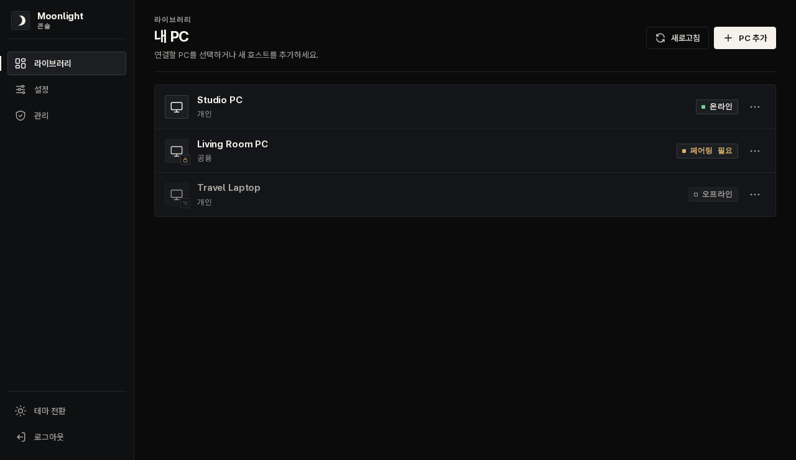
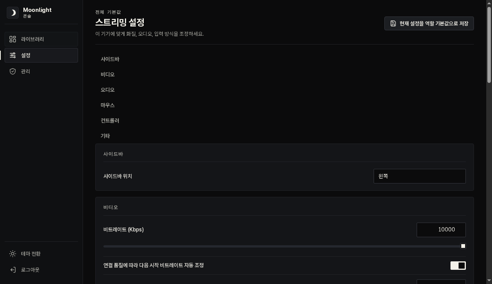

# Moonlight Web — 커뮤니티 포크

**한국어** | [English](README.en.md)

[Sunshine](https://docs.lizardbyte.dev/projects/sunshine/latest/) PC의 앱을 [WebRTC](https://webrtc.org/)로 브라우저에 스트리밍합니다. 새롭게 개편된 Moonlight Web 콘솔은 내 PC, 스트리밍 설정, 관리 기능을 하나의 사이드바에 모았습니다.



이 비공식 [Moonlight](https://moonlight-stream.org/) 클라이언트는 [MrCreativ3001/moonlight-web-stream v2.10.0](https://github.com/MrCreativ3001/moonlight-web-stream/commit/cd9d03cbf9a42b394f7b72a733a2f39cb5f0edd8)을 기반으로 합니다. 원본 스냅샷과 변경 사항은 [CHANGES.md](CHANGES.md)에서 확인할 수 있습니다. 이 프로젝트는 [GPL-3.0-or-later](LICENSE) 라이선스를 따르며, 내장된 Pretendard 글꼴에는 [SIL Open Font License](web/resources/fonts/OFL-Pretendard.txt)가 적용됩니다.

<a id="overview"></a>
## 목차

- [웹 인터페이스](#web-interface)
- [제한 사항](#limitations)
- [설치](#installation)
  - [수동 설치](#install-manually)
  - [Docker 설치](#docker-installation)
- [초기 설정](#setup)
  - [인터넷을 통한 스트리밍](#streaming-over-the-internet)
  - [HTTPS 설정](#configuring-https)
  - [Apache 2 리버스 프록시](#proxying-via-apache-2)
  - [리버스 프록시를 통한 인증](#authentication-using-a-reverse-proxy)
  - [WebSocket 전송 사용](#using-websocket-transport)
- [설정 파일](#config)
- [v2 마이그레이션](#migrating-to-v2)
- [기여자](#contributors)
- [빌드](#building)

<a id="web-interface"></a>
## 웹 인터페이스

- **라이브러리**에는 등록된 PC와 연결 상태가 표시됩니다. 페어링된 PC를 선택하면 앱 목록을 보고 바로 실행할 수 있습니다.
- **설정**에서는 비디오, 오디오, 입력, 전송 방식을 조정합니다. 이 브라우저의 전체 기본값을 지정하거나 PC·앱별 전용 설정을 따로 둘 수 있습니다.
- **관리**에서는 사용자와 역할을 관리합니다. 사이드바 하단에서 **테마 전환**도 할 수 있습니다.
- **스트리밍 중**에는 화면의 스트리밍 제어 메뉴에서 입력 방식을 조정하거나 스트림 **통계**를 확인할 수 있습니다. 선택 기능인 [클립보드 브리지](clipboard-bridge/README.md)를 사용하면 스트림과 호스트 PC의 클립보드를 연동할 수 있습니다.



<details>
<summary>연결 구조 보기</summary>


</details>

<a id="limitations"></a>
## 제한 사항
- [보안 컨텍스트(Secure Context)](https://developer.mozilla.org/en-US/docs/Web/Security/Secure_Contexts#:~:text=They%20must%20be,be%20considered%20deprecated.)에서만 동작하는 기능 -> [보안 컨텍스트 / HTTPS 설정 방법](#configuring-https)
  - 컨트롤러: [Gamepad API](https://developer.mozilla.org/en-US/docs/Web/API/Gamepad_API)
  - 키보드 잠금(OS 키를 포함한 대부분의 키 입력 캡처): [Experimental Keyboard Lock API](https://developer.mozilla.org/en-US/docs/Web/API/Keyboard_API)
  - [WebCodecs API](https://developer.mozilla.org/en-US/docs/Web/API/VideoDecoder)를 사용하는 WebSocket 전송

<a id="installation"></a>
## 설치

이 포크는 [수동](#install-manually) 또는 [Docker](#docker-installation)로 빌드해 실행할 수 있습니다.

<a id="install-manually"></a>
### 수동 설치

1. 스트리밍할 호스트 PC에 [Sunshine](https://docs.lizardbyte.dev/projects/sunshine/latest/)을 설치합니다.
2. [포크를 빌드](#building)한 뒤, `streamer` 실행 파일과 프런트엔드 파일이 준비된 상태에서 `web-server` 실행 파일을 실행합니다.
3. Moonlight Web이 실행 중인 기기에서 `http://localhost:8080`에 접속합니다. 주소와 포트는 [수신 주소와 포트](#bind-address)에서 변경할 수 있습니다.

<a id="docker-installation"></a>
### Docker 설치

저장소 루트에서 이미지를 빌드하고 로컬에서 실행합니다.

```sh
docker build -t moonlight-web-fork -f docker/Dockerfile.source .
docker run --rm --name moonlight-web \
  -p 127.0.0.1:8080:8080 \
  -p 127.0.0.1:40000-40100:40000-40100/udp \
  -v moonlight-server:/moonlight-web/server \
  moonlight-web-fork
```

다른 기기에서 접속하려면 [초기 설정](#setup)과 [HTTPS 설정](#configuring-https)을 참고하세요. 원본 프로젝트의 배포 이미지에 대한 안내는 [원본 Docker 가이드](docker/README.md)에 있습니다.

<a id="setup"></a>
## 초기 설정

1. 사용자 이름과 비밀번호를 입력합니다. 기본 설정에서는 최초 로그인 시 관리자 계정이 자동으로 생성됩니다.
2. **라이브러리**에서 **PC 추가**를 선택한 뒤 Sunshine 호스트 주소를 입력합니다. Moonlight Web 서버에서 접근할 수 있는 주소를 사용하며, Sunshine 기본 포트를 쓰는 경우 포트는 비워 둡니다.
3. 추가한 PC를 선택하고 화면에 표시된 페어링 PIN을 Sunshine에 입력합니다.
4. 페어링된 PC를 열어 실행할 앱을 선택합니다. 스트리밍을 시작하기 전에 **설정**에서 비디오, 오디오, 입력 옵션을 조정할 수 있습니다.

<a id="streaming-over-the-internet"></a>
### 인터넷을 통한 스트리밍

1. 공유기에서 웹 서버 포트를 포워딩합니다(기본값 `8080`, HTTP `80`, HTTPS `443`).<br>
   이 설정은 [`bind_address`](#bind-address) 옵션으로 변경할 수 있습니다.

**로컬 네트워크**에서는 보통 WebRTC 피어 간 연결이 문제없이 협상됩니다.

**인터넷을 통해** 스트리밍할 때는 내장 STUN 서버가 직접 P2P WebRTC 연결을 시도합니다. 대부분의 가정용 네트워크에서는 잘 동작하지만, 사내 방화벽이나 엄격한 NAT 환경에서는 실패할 수 있습니다.

직접 WebRTC 연결을 맺을 수 없을 때는 다음 방법을 사용할 수 있습니다:

1. **TURN 서버 사용(권장)**<br>
   직접 P2P 연결이 차단된 환경에서 WebRTC 트래픽을 안정적으로 중계하려면 [TURN 서버를 구성](#configure-a-turn-server)하세요.

2. **포트 직접 포워딩**<br>
   공유기에서 [필요한 포트를 포워딩](#port-forward)할 수 있습니다.<br>
   단, 방화벽이 UDP 트래픽을 차단하는 경우에는 이 방법도 동작하지 않을 수 있습니다.

3. **대체 수단으로 WebSocket 전송 사용**<br>
   WebSocket은 표준 HTTP/HTTPS 포트를 사용하므로 제한이 심한 네트워크에서도 허용되는 경우가 많아, WebRTC 연결에 실패했을 때 유용한 대안이 됩니다. 자세한 내용은 [WebSocket 전송 사용](#using-websocket-transport)을 참고하세요.

<a id="configure-a-turn-server"></a>
#### TURN 서버 구성
1. [coturn](https://github.com/coturn/coturn) 같은 TURN 서버를 직접 구축·구성하거나 외부 호스팅 서비스를 이용합니다.

2. WebRTC ICE 서버 목록에 TURN 서버를 추가합니다.
```json
{
    "webrtc": {
        "ice_servers": [
            {
                "urls": [
                    "stun:stun.l.google.com:19302",
                    "stun:stun.l.google.com:5349",
                    "stun:stun1.l.google.com:3478",
                    "stun:stun1.l.google.com:5349",
                    "stun:stun2.l.google.com:19302",
                    "stun:stun2.l.google.com:5349",
                    "stun:stun3.l.google.com:3478",
                    "stun:stun3.l.google.com:5349",
                    "stun:stun4.l.google.com:19302",
                    "stun:stun4.l.google.com:5349",
                ]
            },
            {
                "urls": [
                        "turn:yourip.com:3478?transport=udp",
                        "turn:yourip.com:3478?transport=tcp",
                        "turn:yourip.com:5349?transport=tcp"
                ],
                "username": "your username",
                "credential": "your credential"
            }
        ]
    }
}
```
일부 기업 방화벽은 매우 엄격해 443 포트의 TCP 연결만 허용할 수 있습니다. 이 경우 TURN 서버를 443 포트에도 바인딩하고 URL 목록에 `"turn:yourip.com:443?transport=tcp"`를 추가하세요.

<a id="port-forward"></a>
#### 포트 포워딩

1. [설정 파일](#config)에서 WebRTC 피어가 사용할 포트 범위를 고정합니다.
```json
{
    "webrtc": {
        "port_range": {
            "min": 40000,
            "max": 40010
        }
    }
}
```
2. 위에서 지정한 포트 범위를 `udp`로 포워딩합니다.
Windows Defender를 사용 중이라면 NAT Traversal을 허용하세요. 주의: 방화벽이 UDP 연결을 차단하면 이 방법은 동작하지 않으므로 [TURN 서버를 구성](#configure-a-turn-server)해야 합니다.

3. [WebRTC NAT 1:1](#webrtc-nat-1-to-1-ips)을 설정해 [공인 IP](https://whatismyipaddress.com/)를 알립니다(선택 사항: 보통 WebRTC STUN 서버가 자동으로 감지합니다):
```json
{
    "webrtc": {
        "nat_1to1": {
            "ice_candidate_type": "host",
            "ips": [
                "74.125.224.72"
            ]
        }
    }
}
```

PC가 어떤 NAT 유형 뒤에 있는지 확인하면 문제 해결에 도움이 됩니다:
- [NAT Checker](https://www.checkmynat.com/)

<a id="configuring-https"></a>
### HTTPS 설정
Moonlight Web 서버에서 직접 HTTPS를 설정할 수 있습니다.

1. 개인 키와 인증서가 필요합니다.

Python 스크립트 [generate_certificate.py](generate_certificate.py)로 자체 서명 인증서를 생성할 수 있습니다:

```sh
pip install pyOpenSSL
python ./generate_certificate.py
```

2. 생성된 `server/key.pem`과 `server/cert.pem` 파일을 `server` 디렉터리에 복사합니다.

3. 인증서를 사용해 HTTPS를 활성화하도록 [설정 파일](#config)을 수정합니다.
```json
{
    "web_server": {
        "certificate": {
            "private_key_pem": "./server/key.pem",
            "certificate_pem": "./server/cert.pem"
        }
    }
}
```

<a id="proxying-via-apache-2"></a>
### Apache 2 리버스 프록시
[Apache 2](https://httpd.apache.org/)를 사용해 Moonlight Web 사이트를 프록시할 수 있습니다.

참고:
HTTPS를 사용하려면 Apache 2가 HTTPS 암호화를 모두 처리하도록 Moonlight Web 서버는 HTTP로 실행해야 합니다.

1. `mod_proxy`와 `mod_proxy_wstunnel` 모듈을 활성화합니다.

```sh
sudo a2enmod mod_proxy mod_proxy_wstunnel
```

2. `/etc/apache2/conf-available/moonlight-web.conf` 파일을 만들고 아래 내용을 입력합니다:
```
# Example subpath "/moonlight" -> To connect you'd go to "http://yourip.com/moonlight/"
Define MOONLIGHT_SUBPATH /moonlight
# The address and port of your Moonlight Web server
Define MOONLIGHT_STREAMER YOUR_LOCAL_IP:YOUR_PORT

ProxyPreserveHost on
        
# Important: This WebSocket will help negotiate the WebRTC Peers
<Location ${MOONLIGHT_SUBPATH}/api/host/stream>
        ProxyPass ws://${MOONLIGHT_STREAMER}${MOONLIGHT_SUBPATH}/api/host/stream
        ProxyPassReverse ws://${MOONLIGHT_STREAMER}${MOONLIGHT_SUBPATH}/api/host/stream
</Location>

ProxyPass ${MOONLIGHT_SUBPATH}/ http://${MOONLIGHT_STREAMER}${MOONLIGHT_SUBPATH}/
ProxyPassReverse ${MOONLIGHT_SUBPATH}/ http://${MOONLIGHT_STREAMER}${MOONLIGHT_SUBPATH}/
```

3. 생성한 설정 파일을 활성화합니다.
```sh
sudo a2enconf moonlight-web
```

4. [경로 접두사](#url-path-prefix)를 포함하도록 [설정 파일](#config)을 수정합니다.
```json
{
    "web_server": {
        "url_path_prefix": "/moonlight"
    }
}
```

5. 인증서로 HTTPS를 적용합니다(선택 사항).

<a id="authentication-using-a-reverse-proxy"></a>
### 리버스 프록시를 통한 인증
리버스 프록시 인증은 프록시가 사용자 요청에 사용자 지정 헤더를 추가하는 방식으로 동작합니다. 아래 예시에서는 사용자 이름 헤더로 `X-Forwarded-User`를 사용합니다.

<b>외부 요청에서 이 헤더를 임의로 변경할 수 없도록 차단하고, 반드시 프록시만 설정할 수 있게 구성하세요.</b>

[헤더로 전달하는 사용자 이름](#forwarded-header-username) 옵션을 지정하면 프록시 인증이 활성화됩니다.
설정 파일에 명시하지 않아도 [미등록 사용자 자동 생성](#forwarded-header-auto-create-missing-user) 옵션은 기본적으로 켜져 있습니다.
```json
{
    "web_server": {
        "forwarded_header": {
            "username_header": "X-Forwarded-User",
            "auto_create_missing_user": true
        }
    }
}
```

<a id="using-websocket-transport"></a>
### WebSocket 전송 사용

사내망이나 제한이 심한 네트워크에서는 WebRTC 연결을 맺기 어렵거나 아예 불가능할 수 있습니다.
이런 환경에서는 서버가 이미 노출한 HTTP 또는 HTTPS 포트를 그대로 사용해 **WebSocket**으로 데이터를 스트리밍할 수 있습니다.

**데이터 전송 방식** 옵션을 **웹 소켓 (Web Socket)**으로 설정하면 WebSocket 전송을 강제로 사용할 수 있습니다.

WebSocket 스트리밍을 사용할 때는 다음 사항을 유의하세요:

- 브라우저의 `VideoDecoder` API는 사이트가 **HTTPS**(보안 컨텍스트)로 제공될 때만 사용할 수 있습니다.

- 보안 컨텍스트가 아닌 환경에서는 구형 비디오 재생 API로 대체되며, 눈에 띄는 지연 시간이 발생할 수 있습니다.

- 이 지연을 피해야 하고 구성을 직접 다룰 수 있다면 소프트웨어 기반 디코더를 사용할 수 있습니다:
  - 브라우저용 커스텀 [openh264](https://github.com/MrCreativ3001/openh264-js)를 빌드합니다.
  - 이 빌드를 사용하면 `VideoDecoder` API에 의존하지 않고 브라우저에서 비디오 프레임을 직접 디코딩할 수 있습니다.
  - 빌드 후 생성된 `decoder.js` 파일을 아래 경로에 복사합니다:
    ```
    static/libopenh264/decoder.js
    ```
  - 디코더가 자동으로 감지되어 사용됩니다.

<a id="config"></a>
## 설정 파일
설정 파일은 실행 파일 기준 `server/config.json`에 위치합니다.
Moonlight Web 구성에 필요한 주요 설정은 다음과 같습니다.

대부분의 옵션은 명령줄 인수나 환경 변수로도 지정할 수 있습니다.
```sh
./web-server help
```

전체 설정 항목은 [Rust 설정 모듈](common/src/config.rs)에서 확인할 수 있습니다.

<a id="bind-address"></a>
### 수신 주소와 포트
웹 사이트가 수신 대기할 주소와 포트입니다.

```json
{
    "web_server": {
        "bind_address": "0.0.0.0:8080"
    }
}
```

<a id="default-user"></a>
### 기본 사용자
로그인하지 않았을 때 기본으로 선택되는 사용자 ID입니다.
**관리** 패널에서 기본값으로 지정할 사용자의 **사용자 ID**를 확인하세요.

```json
{
    "web_server": {
        "default_user_id": 1284358932
    }
}
```

<a id="https-certificates"></a>
### HTTPS 인증서
설정하면 웹 서버가 지정된 인증서로 HTTPS를 사용합니다.

```json
{
    "web_server":{
        "certificate": {
            "private_key_pem": "./server/key.pem",
            "certificate_pem": "./server/cert.pem"
        }
    }
}
```

<a id="webrtc-port-range"></a>
### WebRTC 포트 범위
WebRTC 통신에 사용할 웹 서버의 포트 범위를 지정합니다.

```json
{
    "webrtc": {
        "port_range": {
            "min": 40000,
            "max": 40010
        }
    }
}
```

<a id="webrtc-ice-servers"></a>
### WebRTC ICE 서버
WebRTC가 사용할 ICE 서버 목록입니다.

```json
{
    "webrtc": {
        "ice_servers": [
            {
                "urls": [
                    "stun:stun.l.google.com:19302",
                    "stun:stun.l.google.com:5349",
                    "stun:stun1.l.google.com:3478",
                    "stun:stun1.l.google.com:5349",
                    "stun:stun2.l.google.com:19302",
                    "stun:stun2.l.google.com:5349",
                    "stun:stun3.l.google.com:3478",
                    "stun:stun3.l.google.com:5349",
                    "stun:stun4.l.google.com:19302",
                    "stun:stun4.l.google.com:5349",
                ]
            }
        ]
    }
}
```

환경 변수로도 ICE 서버를 지정할 수 있습니다:
```dockerfile
ENV WEBRTC_ICE_SERVER_0_URL=stun:stun.l.google.com:5349
ENV WEBRTC_ICE_SERVER_0_USERNAME=name
ENV WEBRTC_ICE_SERVER_0_CREDENTIAL=cred
ENV WEBRTC_ICE_SERVER_1_URL=stun:stun1.l.google.com:5349
```
이는 아래 ICE 서버 설정에 해당합니다:
```json
{
    "webrtc": {
        "ice_servers": [
            {
                "urls": [
                    "stun:stun.l.google.com:19302",
                ],
                "username": "name",
                "credential": "cred"
            },
            {
                "urls": [
                    "stun:stun1.l.google.com:5349"
                ]
            }
        ]
    }
}
```

최초 실행 시 CLI 인수 `--disable-default-webrtc-ice-servers` 또는 환경 변수 `DISABLE_DEFAULT_WEBRTC_ICE_SERVERS`로 기본 ICE 서버를 모두 비활성화할 수 있습니다.
`config.json`이 생성된 이후에는 기본값이라 하더라도 파일 안에 기록된 모든 ICE 서버가 사용됩니다.

<a id="webrtc-ice-server-script"></a>
### WebRTC ICE 서버 스크립트
스트림이 시작될 때마다 지정한 스크립트를 실행해 ICE 서버 목록을 동적으로 생성합니다.

```json
{
    "webrtc": {
        "ice_server_script": "./server/ice_server_script.sh"
    }
}
```

스크립트는 [WebRTC ICE 서버](#webrtc-ice-servers) 설정 옵션과 동일한 구조의 JSON 배열을 출력해야 합니다.

Linux용 bash 스크립트 예시:
```sh
#!/bin/bash

# Assign arguments to variables
username="user"
credential="cred"

# Output the json into stdout
echo "[
    {
        \"urls\": [
            \"turn:example.com\"
        ],
        \"username\": \"$username\",
        \"credential\": \"$credential\"
    }
]"
```

Windows용 배치 스크립트 예시:
```bat
@echo off

:: Assign arguments to variables
set "username=user"
set "credential=cred"

:: Output the JSON with dynamic values
echo [
echo     {
echo         "urls": [
echo             "turn:example.com"
echo         ],
echo         "username": "%username%",
echo         "credential": "%credential%"
echo     }
echo ]
```

<a id="webrtc-nat-1-to-1-ips"></a>
### WebRTC 1:1 NAT 주소
지정한 IP를 웹 서버의 ICE 후보로 알립니다.
설정해 두는 것을 권장하지만, 보통 STUN 서버가 공인 IP를 자동으로 파악합니다.

`ice_candidate_type`:
- `host` -> 클라이언트가 직접 연결할 수 있는 서버의 IP 주소입니다.
- `srflx` -> STUN 서버가 추가하는 ICE 후보처럼 이 서버의 공인 IP 주소입니다.

```json
{
    "webrtc": {
        "nat_1to1": {
            "ice_candidate_type": "host",
            "ips": [
                "74.125.224.72"
            ]
        }
    }
}
```

CLI 인수 `--webrtc-nat-1to1-host` 또는 환경 변수 `WEBRTC_NAT_1TO1_HOST`로 IP를 `host` 후보 유형으로 지정할 수도 있습니다. 위 JSON 설정과 동일하게 동작합니다.
```dockerfile
ENV WEBRTC_NAT_1TO1_HOST=74.125.224.72
```

<a id="webrtc-network-types"></a>
### WebRTC 네트워크 유형
WebRTC가 허용할 네트워크 유형을 지정합니다.
<br>허용 값:
- udp4: IPv4 기반 모든 UDP
- udp6: IPv6 기반 모든 UDP
- tcp4: IPv4 기반 모든 TCP
- tcp6: IPv6 기반 모든 TCP

```json
{
    "webrtc": {
        "network_types": [
            "udp4",
            "udp6",
        ]
    }
}
```

<a id="url-path-prefix"></a>
### URL 경로 접두사
[Apache 2](#proxying-via-apache-2) 같은 서비스로 웹 페이지를 하위 경로에 라우팅할 때 유용합니다.
웹 사이트가 보내는 모든 요청에 지정한 접두사를 자동으로 붙입니다.

```json
{
    "web_server": {
        "url_path_prefix": "/moonlight"
    }
}
```

<a id="forwarded-header-username"></a>
### 헤더로 전달하는 사용자 이름
웹 서버에 인증된 사용자 이름을 전달할 HTTP 헤더 이름입니다.

```json
{
    "web_server": {
        "forwarded_header": {
            "username_header": "X-Forwarded-User"
        }
    }
}
```

<a id="forwarded-header-auto-create-missing-user"></a>
### 헤더로 전달된 사용자 자동 생성
[username_header](#forwarded-header-username)로 전달된 사용자가 존재하지 않을 때 새 사용자를 자동으로 생성합니다.

```json
{
    "web_server": {
        "forwarded_header": {
            "auto_create_missing_user": true
        }
    }
}
```

<a id="migrating-to-v2"></a>
## v2 마이그레이션
1. 일부 설정 옵션이 변경되었으므로 기존 설정 파일 이름을 `old_config.json` 등으로 바꿔 백업합니다.

2. 웹 서버를 실행해 새 설정 파일을 생성합니다.

3. 기존 설정 값을 새 설정 파일로 옮깁니다.

4. 처음 로그인하는 사용자가 관리자 계정으로 생성되며, 기존에 저장된 모든 호스트가 해당 사용자로 이전됩니다.

기타 변경 사항:
- 프록시 경로 변경:
  - `ProxyPass ${MOONLIGHT_SUBPATH}/ http://${MOONLIGHT_STREAMER}/`<br>를 모두 `ProxyPass ${MOONLIGHT_SUBPATH}/ http://${MOONLIGHT_STREAMER}${MOONLIGHT_SUBPATH}/`로 변경하세요.
  - [Apache 2 리버스 프록시(업스트림 v2 안내)](https://github.com/MrCreativ3001/moonlight-web-stream/tree/v2?tab=readme-ov-file#proxying-via-apache-2)

<a id="contributors"></a>
## 기여자
- Tesla 브라우저에서도 실행할 수 있게 Canvas 렌더러를 구현해 주신 [@Argon2000](https://github.com/Argon2000)님께 감사드립니다.
- 멋진 새 GUI를 만들어 주신 [@Maneetbal](https://github.com/Maneetbal)님께 감사드립니다.
- GitHub CI를 구축해 주신 [@chromaticpipe](https://github.com/chromaticpipe)님께 감사드립니다.
- HDR 지원을 구현해 주신 [@qiin2333](https://github.com/qiin2333)님께 감사드립니다.
- 컨텍스트 메뉴 오류를 수정하고 앱 이미지 캐싱을 구현해 주신 [@Idefix2020](https://github.com/Idefix2020)님께 감사드립니다.

<a id="building"></a>
## 빌드
이 포크를 클론합니다:
```sh
git clone https://github.com/hibye-ai/moonlight-web.git
cd moonlight-web
```
Node.js 24와 [rust-toolchain.toml](rust-toolchain.toml)에 고정된 [Rust](https://www.rust-lang.org/tools/install) nightly를 사용하세요. Docker 빌드와 네이티브 의존성은 [Build this fork](CHANGES.md#build-this-fork)를 참고하세요.

Moonlight Web은 두 가지 방법으로 빌드할 수 있습니다:
- 현재 시스템에서 직접 빌드

  시스템에서 직접 빌드하려면 웹 서버와 스트리머 바이너리 컴파일 방법을 확인하세요:
  - [moonlight web server](#crate-moonlight-web-server)
  - [moonlight web streamer](#crate-moonlight-web-streamer)
  - [moonlight common rust](https://github.com/MrCreativ3001/moonlight-common-rust/tree/master/examples#client-common-c)

- [Cargo Cross](https://github.com/cross-rs/cross)로 크로스 컴파일(cross-rs 이미지의 C/C++ 컴파일러가 구버전이라 대부분의 타깃에서는 동작하지 않습니다)

  cross 설치가 완료되었다면 프로젝트 루트 디렉터리에서 아래 명령을 실행합니다.
  [웹 서버](#crate-moonlight-web-server)와 [스트리머](#crate-moonlight-web-streamer)가 함께 컴파일됩니다.
  ```sh
  cross build --release --target YOUR_TARGET
  ```
  참고: Windows는 GNU 타깃(`x86_64-pc-windows-gnu`)만 지원합니다.

<a id="crate-moonlight-web-server"></a>
### 크레이트: Moonlight Web Server
`src/`에 있는 Moonlight Web용 웹 서버입니다.
각 스트림을 처리하기 위해 여러 [스트리머](#crate-moonlight-web-streamer)를 하위 프로세스로 실행합니다.

[npm](https://docs.npmjs.com/downloading-and-installing-node-js-and-npm)으로 웹 프런트엔드를 빌드합니다.
```sh
npm ci
npm run build
```
빌드 결과물은 `dist/`에 생성됩니다.

컴파일 모드에 따라 프런트엔드 폴더 이름을 맞춰야 합니다:
- debug 모드 -> 폴더 이름이 `dist/`여야 합니다.
- release 모드 -> 폴더 이름이 `static/`이어야 합니다.

<a id="crate-moonlight-web-streamer"></a>
### 크레이트: Moonlight Web Streamer
`streamer/`에 있는 [웹 서버](#crate-moonlight-web-server)의 스트리머 하위 프로세스입니다.
웹 서버와 stdin/stdout으로 통신해 WebRTC 피어를 협상한 뒤, 해당 피어를 통해 통신을 이어갑니다.
